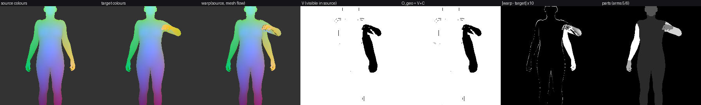
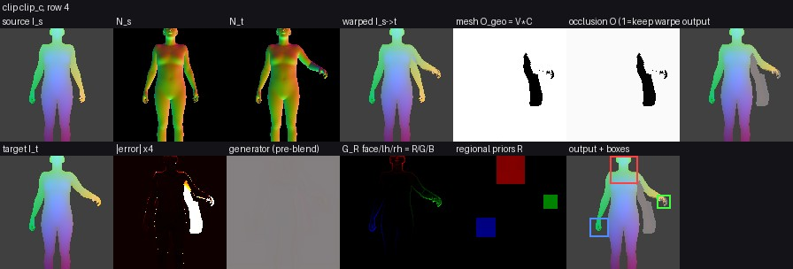
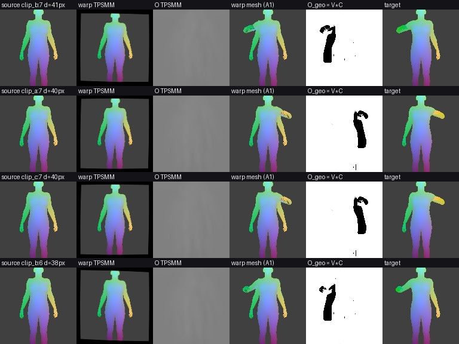

# Kiến trúc cải tiến A1 + B1 cho GReg

Branch `feat/mesh-flow-regions`. Tài liệu này mô tả **chính xác** mô hình sau cải tiến chạy như thế nào: dữ liệu đi qua những bước nào, mỗi bước tính gì, công thức gì, nằm ở file nào, bật/tắt bằng config nào.

- **A1 — Flow và mặt nạ nhìn thấy tính từ mesh SMPL-X** (thay TPSMM).
- **B1 — Vùng tay/mặt sát theo hình học** (thay ô vuông cố định 64×64).

Hai cải tiến **độc lập**: mỗi cái có công tắc riêng, chạy được một mình hoặc cùng nhau. Khi tắt cả hai, mô hình chạy **y hệt** code cũ (cùng kết quả từng bit).

Tài liệu liên quan: `docs/huong_cai_tien_keo_tay.md` (vì sao chọn A1/B1), `docs/decisions.md` (các lựa chọn của bản tái hiện gốc).

---

## Mục lục

1. [Vấn đề cần giải](#1-vấn-đề-cần-giải)
2. [Tổng quan: trước và sau](#2-tổng-quan-trước-và-sau)
3. [Luồng dữ liệu đầu-cuối](#3-luồng-dữ-liệu-đầu-cuối)
4. [A1 chi tiết: tương ứng từ mesh](#4-a1-chi-tiết-tương-ứng-từ-mesh)
5. [B1 chi tiết: vùng sát và loss có mặt nạ](#5-b1-chi-tiết-vùng-sát-và-loss-có-mặt-nạ)
6. [Hàm mất mát tổng](#6-hàm-mất-mát-tổng)
7. [Giao thức huấn luyện và chỉ số đánh giá](#7-giao-thức-huấn-luyện-và-chỉ-số-đánh-giá)
8. [Config và ma trận ablation](#8-config-và-ma-trận-ablation)
9. [Đã kiểm chứng những gì](#9-đã-kiểm-chứng-những-gì)
10. [Chạy trên vast.ai](#10-chạy-trên-vastai)
11. [Giới hạn, rủi ro, việc tiếp theo](#11-giới-hạn-rủi-ro-việc-tiếp-theo)
12. [Bản đồ file](#12-bản-đồ-file)

---

## 1. Vấn đề cần giải

Kết quả run3 (xem `docs/huong_cai_tien_keo_tay.md`) cho thấy lỗi "kéo tay" có hai gốc độc lập:

| Gốc lỗi | Biểu hiện trong run3 | Cải tiến |
|---|---|---|
| Flow TPSMM (10 phép TPS mượt, lưới 64×64) không gập được cẳng tay qua thân | ống tay áo bị kéo giãn như cao su | **A1** |
| Mặt nạ che khuất O học ở 64×64, mềm | tay "ma" bán trong suốt, còn vệt tay cũ | **A1** |
| Generator phải tự vẽ cả cánh tay | mờ; GReg chỉ hơn ảnh warp 1.5% (L1 0.0330 vs 0.0335) | **A1** (để generator chỉ vẽ phần thật sự bị che) |
| Ô vùng tay 64×64 cố định, bàn tay chỉ chiếm ~15% | loss vùng tay bị nền chi phối; prior của hand expert gần như trống | **B1** |
| Train lấy cặp khung ngẫu nhiên, test luôn lấy khung tay buông làm nguồn | mô hình hiếm khi thấy chuyển động lớn khi train | `source_first_prob` (mục 7) |
| L1 toàn ảnh bị nền tĩnh chi phối | sweep chỉ đo được nhiễu | chỉ số vùng + chia bin (mục 7) |

**Ý tưởng cốt lõi của A1.** Ta đã có mesh SMPL-X của **cả** khung nguồn lẫn khung đích (khớp ảnh thật, sai số khoảng 2.5 px kể cả ngón tay). Hai mesh có **cùng topology**: đỉnh thứ *i* ở nguồn và ở đích là cùng một điểm trên cơ thể. Vì vậy không cần *đoán* chuyển động: một pixel đích nhìn thấy tam giác *f* tại toạ độ barycentric *b* thì cũng chính điểm đó nằm ở `Σ b_k · uv_nguồn[f_k]` trong ảnh nguồn. Che khuất được giải bằng z-buffer, giống như lúc render.

---

## 2. Tổng quan: trước và sau

```
                 GReg GỐC (paper)                                GReg + A1 + B1
 ┌───────────────────────────────────┐          ┌──────────────────────────────────────────────┐
 │ N_s, N_t ─► TPSMM (học, 49M tham số)│          │ SMPL-X_s, SMPL-X_t, faces_s, faces_t (cache) │
 │            └► F (64×64), O (64×64)  │          │   └► MeshCorrespondence (KHÔNG học, ~0 tham số)│
 │                                     │          │        └► F (256×256), V, C, parts_t         │
 │                                     │          │        O = sigmoid(logit(V·C) + Refiner(...)) │
 │ I_st = warp(I_s, F)                 │          │ I_st = warp(I_s, F)                          │
 │ boxes = ô 64×64 quanh tâm           │          │ boxes: mặt 64×64; tay = vừa khít bàn tay      │
 │ RPG, GR, Generator (như paper)      │          │ RPG, GR, Generator (như paper)               │
 │ Î = O·I_st + (1−O)·I_gen            │          │ Î = O·I_st + (1−O)·I_gen                      │
 │ loss vùng trên toàn ô vuông         │          │ loss vùng × mặt nạ tay/mặt từ mesh           │
 └───────────────────────────────────┘          └──────────────────────────────────────────────┘
 Cần: stage 1 (train TPSMM 100 epoch)            Cần: chạy 02c_mesh_buffers.py một lần (không train)
```

**Những gì KHÔNG đổi:** Style encoder, Regional Experts (RPG), Gradient encoder + GRM, Generator UNet, discriminator vùng, công thức blend cuối, toàn bộ hyper-parameter của paper. A1/B1 chỉ thay **nguồn của F, O** và **cách cắt vùng / tính loss vùng**.

---

## 3. Luồng dữ liệu đầu-cuối

### 3.1 Tiền xử lý (một lần)

```
video .mp4 + .pkl SignAvatars
   │  02_preprocess_hamnosys.py  (như cũ)
   ▼
cache/frames, normals, parts, joints, meta.json
   │  02b_mark_valid_rows.py      (như cũ: bỏ khung fade-in/out)
   │  04_make_splits.py           (như cũ)
   │  02c_mesh_buffers.py         (MỚI, A1; không giải mã lại video)
   ▼
cache/faces/<key>/<row>.png   uint16: chỉ số tam giác SMPL-X + 1 tại mỗi pixel (0 = nền)
cache/mesh/<key>.npz          smplx (N,182), focal (N,2), princpt (N,2) — camera ĐÃ crop
```

`02c` render lại mỗi khung với **đúng** camera mà `02` đã dùng (đọc hộp crop từ `meta.json`), và lưu chỉ số tam giác thấy được ở mỗi pixel. Cờ `--check` so mặt nạ thân render lại với kênh alpha của `normals/*.png`: hai cái phải khớp (smoke test: lệch 0.00000). Đỉnh mesh **không** được lưu: lúc train chúng được tính lại từ vector SMPL-X trên GPU (vài ms), nên cache chỉ tăng khoảng 1 KB/khung cộng một PNG chỉ số tam giác.

### 3.2 Một bước huấn luyện (`scripts/06_train_greg.py`)

```
PairDataset (greg/data/dataset.py)
   nguồn s, đích t trong cùng clip  (xác suất source_first_prob: s = khung hợp lệ đầu)
   trả: source_/target_ image, normal, centers, joints, [parts], [faces, smplx, focal, princpt]
        │
        ▼  model.extra_inputs(batch)        (greg/models/greg.py)
   ├─ geometry = MeshCorrespondence(...)    chỉ khi model.flow.type = mesh   (A1, mục 4)
   ├─ joints_target                          cho ô tay vừa khít             (B1, mục 5.1)
   └─ parts_target                           từ geometry (mesh) hoặc parts/*.png (TPSMM)
        │
        ▼  model(I_s, N_s, N_t, centers_t, **extra)
   F, O        ← geometry (A1)  hoặc  TPSMM đóng băng (paper)
   I_st        = warp(I_s, F)
   boxes       = adaptive (B1) hoặc ô cố định (paper)
   R           = RPG(crop(N_t, boxes), style(I_s))
   G_R, X_g    = Gaussians(centers) · grad(N_t) → GradientEncoder
   I_gen       = Generator([I_st, N_t, R]; GRM(X_g))
   Î           = O·I_st + (1−O)·I_gen
   region_masks = mặt nạ phần thân của từng vùng trong ô của nó (B1)
        │
        ▼  GRegLoss.generator_loss / discriminator_loss   (greg/losses.py, mục 6)
```

### 3.3 Đánh giá

`greg/eval/evaluate.py` dùng giao thức reconstruction của paper: nguồn là khung hợp lệ đầu, đích là mọi khung còn lại. Hàm này được dùng chung cho validation trong 06, `07_eval_reconstruction.py`, `11_sweep.py` và `13_visualize.py`. Mọi call site gọi `model(..., **model.extra_inputs(batch))`, nên **cùng một code** chạy mọi cấu hình.

---

## 4. A1 chi tiết: tương ứng từ mesh

Code: `greg/geometry/mesh_flow.py`. Hàm lõi `correspond(...)` là torch thuần (test được bằng mesh tổng hợp). Lớp `MeshCorrespondence` bọc thêm bước SMPL-X forward.

### 4.1 Đầu vào

| Tên | Shape | Ý nghĩa |
|---|---|---|
| `uvz_s`, `uvz_t` | (B, V, 3) | đỉnh SMPL-X chiếu lên ảnh 256²: (u, v) pixel, z = độ sâu camera (mét). V = 10 475 |
| `faces_s`, `faces_t` | (B, H, W) long | tam giác nhìn thấy tại mỗi pixel (−1 = nền), đọc từ `cache/faces` |
| `faces` | (F, 3) | topology SMPL-X, F = 20 908 |
| `face_part` | (F,) | nhãn tam giác: 0 nền, 1 thân, 2 mặt, 3 tay trái, 4 tay phải, **5 cánh tay trái, 6 cánh tay phải** |

`uvz` được tính bởi `MeshCorrespondence.vertices`: SMPL-X forward → `project` / `to_camera` của `greg/render/body.py`. Đây **đúng là** camera dùng để render normal map (`cam_trans` lấy từ vector, `focal`/`princpt` là camera đã crop lưu trong `mesh/<key>.npz`).

Quy ước pixel (giống rasterizer): tâm pixel (i, j) nằm ở toạ độ x = j, y = i.

### 4.2 Bước 1 — Pixel đích ở đâu trong ảnh nguồn

Với mỗi pixel đích `p` thuộc thân (`f = faces_t(p) ≥ 0`):

```
b   = barycentric_2d(p, uv_t[f])            toạ độ barycentric của p trong tam giác đích (giải tích, 2D)
q   = Σ_k b_k · uv_s[f_k]                    vị trí CÙNG điểm bề mặt đó trong ảnh nguồn
z_q = Σ_k b_k · z_s[f_k]                     độ sâu của điểm đó ở camera nguồn
```

Với pixel nền (`f = −1`): camera tĩnh nên `q = p`.

Đầu ra cho `grid_sample(align_corners=True)` (hàm `warp` có sẵn):
`grid = (2·q_x/(W−1) − 1, 2·q_y/(H−1) − 1)`, độ phân giải **đầy đủ 256²** (TPSMM chỉ có 64²).

### 4.3 Bước 2 — Điểm đó có nhìn thấy trong ảnh nguồn không (V)

Pixel thân `p` có **V = 1** khi và chỉ khi **cả bốn** điều kiện sau đúng:

| # | Điều kiện | Vì sao cần |
|---|---|---|
| 1 | `q` nằm trong khung hình | không có gì để lấy mẫu ngoài khung |
| 2 | **Mặt trước ở nguồn:** diện tích có dấu 2D của tam giác `f` ở nguồn cùng dấu với ở đích | đích thấy `f` từ phía trước; nếu ở nguồn chiều quấn bị đảo thì `f` quay lưng lại camera. Ví dụ: lòng bàn tay úp vào đùi ở khung nguồn |
| 3 | **Cùng mảnh bề mặt:** pixel nguồn `round(q)` (chính pixel sẽ được lấy mẫu) hiển thị `f` hoặc một tam giác chung đỉnh với `f` | loại ngón tay bị ngón khác che (cách nhau ~5 mm) và điểm cánh tay rơi đúng vào thân ngay sát viền cánh tay |
| 4 | **Không có gì ở phía trước:** `depth_s(round(q)) ≥ z_q − eps_depth` (eps = 1 cm) | z-buffer kinh điển |

Riêng **pixel viền tĩnh**: nếu `p` nằm trên viền thân ở đích và `round(q)` rơi ra ngoài phần phủ của mesh nguồn chỉ vì làm tròn, thì điều kiện 3 được xét trên lân cận 3×3. Pixel **bên trong** cánh tay mà rơi ra ngoài viền nguồn thì không được nới: đó là bề mặt bị nhìn xiên ở nguồn, lấy mẫu sẽ ra nền.

Pixel **nền** `p` có V = 1 khi mesh nguồn không phủ `p`, và **nếu** `p` nằm trong `bg_dilate_px` (4 px) quanh thân nguồn thì nó cũng phải nằm trong 4 px quanh thân đích.
- Gần chi **đã rời đi**: ảnh nguồn vẫn còn mép tay áo thật (mesh mỏng hơn người mặc áo), copy sẽ để lại "vệt tay cũ", nên V = 0.
- Gần phần thân **đứng yên**: cả hai viền gần nhau, pixel nguồn là đúng, nên V = 1. Nhờ vậy generator không phải vẽ lại cả viền thân ở mọi khung.

Cuối cùng **lấp lỗ đơn pixel**: pixel V = 0 có ≥ 7/8 hàng xóm V = 1 thì đặt V = 1. Một vùng bị che thật luôn lớn hơn 1 pixel. Lỗ đơn đến từ tam giác SMPL-X nhỏ hơn pixel ở ngón tay/mặt, và viền xê dịch 1 px khi skinning.

> **Nguyên tắc thiết kế:** khi không chắc thì chọn V = 0. Đánh dấu nhầm "che" thì generator vẽ pixel đó (an toàn). Đánh dấu nhầm "thấy" thì copy nhầm bề mặt, chính là lỗi bóng ma đang cần sửa.

### 4.4 Bước 3 — Độ tin cậy theo độ giãn (C)

```
C(p) = clamp( |det ∂q/∂p| / stretch_tau , 0, 1 )      (sai phân trung tâm, chỉ trên pixel thân "bên trong")
```

`|det ∂q/∂p|` là số pixel nguồn ứng với một pixel đích. Nếu nhỏ hơn `stretch_tau = 0.5`, vùng đó bị **phóng to** khi warp (ví dụ bàn tay nhìn nghiêng ở nguồn, xòe chính diện ở đích), nên ảnh warp sẽ mờ. Ta hạ độ tin cậy để generator đóng góp nhiều hơn. Viền và nền giữ C = 1, vì V đã xử lý chúng.

### 4.5 Bước 4 — Mặt nạ blend O

```
O_geo = V · C                                                         (B, 1, 256, 256)
O     = sigmoid( logit(clamp(O_geo, 0.02, 0.98)) + OcclusionRefiner([I_st, N_t, O_geo]) )
```

`OcclusionRefiner` (`greg/models/greg.py`) gồm 4 conv 3×3 (dilation 1, 2, 4), 32 kênh, chạy ở độ phân giải đầy đủ. **Conv cuối khởi tạo bằng 0**, nên lúc bắt đầu `O = O_geo`. Nó học phần dư cho những gì mesh không mô hình được (tay áo rộng, tóc). Loss `occ = |O − O_geo|` (trọng số 0.1) giữ nó không trôi xa hình học. Tắt bằng `model.occlusion_refine: false` thì `O = O_geo`.

Blend cuối giữ nguyên paper: `Î = O · I_st + (1 − O) · I_gen`.

### 4.6 Đầu ra của `correspond`

| Khoá | Shape | Dùng ở đâu |
|---|---|---|
| `grid` | (B, H, W, 2) | `warp(I_s, grid)` |
| `visibility` V | (B, 1, H, W) | chỉ số `disocc_frac`, panel |
| `confidence` C | (B, 1, H, W) | panel |
| `occlusion` = V·C | (B, 1, H, W) | đầu vào của refiner / O |
| `parts` | (B, H, W) | mặt nạ vùng B1, `masked_l1`, `arm_l1` |
| `source_coords` q | (B, H, W, 2) | chẩn đoán |

Cả hàm chạy trong `torch.no_grad()`, không có tham số học, không lưu vào checkpoint.

---

## 5. B1 chi tiết: vùng sát và loss có mặt nạ

Code: `greg/data/regions.py`, `greg/models/greg.py`, `greg/losses.py`.

### 5.1 Ô vùng vừa khít (`regions.mode: adaptive`)

```
extent_r = cạnh lớn nhất của hộp bao các khớp vùng r      (region_extents_from_joints: cổ tay + 15 khớp ngón + 5 đầu ngón)
side_tay = clamp( extent · (1 + 2·hand_margin), min_side, max_side )      = clamp(extent · 1.5, 24, 96)
side_mặt = region_size (64)                                                (mặt vốn đã vừa; adaptive_face: true để đổi)
x0 = cx − side/2 + 0.5,  y0 = cy − side/2 + 0.5,  kẹp để ô nằm trong khung
```

Khớp tay lấy từ hình học, nên **có sẵn lúc test** (không cần ảnh đích).

**Hai định dạng ô** (phân biệt bằng chiều cuối của tensor):
- `(B, R, 2)` long `(x0, y0)`: ô cố định của paper, cắt/dán bằng indexing.
- `(B, R, 3)` float `(x0, y0, side)`: ô thích ứng, cắt bằng `grid_sample` song tuyến về patch `region_size × region_size`, dán bằng ánh xạ ngược.

Mọi chỗ dùng `crop_regions`/`paste_regions` tự chọn theo định dạng: RPG, loss, panel, đánh giá. Ô thích ứng có `side = region_size` và `x0` nguyên cho kết quả **trùng** ô cố định (có test).

Hệ quả: bàn tay 25 px giờ lấp đầy patch 64×64 (phóng khoảng 1.7×) thay vì chỉ chiếm 15%. Hand expert, VGG vùng và discriminator vùng **nhìn thấy bàn tay**.

### 5.2 Mặt nạ vùng

```
mask_full_r = soften3x3( dilate( parts_t == label_r , mask_dilate_px=3 ) )     label: mặt 2, tay trái 3, tay phải 4
region_masks[:, r] = crop(mask_full_r, box_r)                                  (B, R, 1, s, s)
```

Giãn 3 px vì mesh lệch khoảng 2.5 px và không có tay áo. `parts_t` lấy từ `geometry["parts"]` (A1) hoặc `parts/*.png` (khi chạy TPSMM). Vì vậy **B1 không cần A1**.

### 5.3 Loss vùng có mặt nạ (`loss.region_mask_mode: multiply`)

Với mỗi vùng r, gọi m là mặt nạ vùng:

```
crop_thật ← crop_thật · m,   grad_thật ← grad_thật · m          (trước VGG vùng và discriminator vùng)
crop_giả  ← crop_giả  · m,   grad_giả  ← grad_giả  · m
L_struct_r = Σ w·|R_r − S_r| / Σ w,     w = m + struct_bg_weight·(1 − m)      (struct_bg_weight = 0.1)
```

Mục tiêu cấu trúc `S_r` (gradient của crop thật) **không** bị nhân mặt nạ, mà chỉ được trọng số hoá. Nhờ vậy RE vẫn học được đường viền ngoài tay. Phần nền quanh tay không còn chi phối VGG vùng và discriminator.

---

## 6. Hàm mất mát tổng

```
L_G = λ_per·L_per(Î, I_t)                                   VGG đa tỉ lệ toàn ảnh             (paper)
    + λ_rper·Σ_r vis_r·L_per(up(crop_r(Î)·m_r), up(crop_r(I_t)·m_r))                           (paper; ·m_r = B1)
    + λ_struct·L_struct                                     (B1: có trọng số mặt nạ)
    + λ_adv·L_adv(D_r(crop_r(Î)·m_r, grad·m_r))             (paper; ·m_r = B1)
    + λ_occ·|O − O_geo|                                     (A1, chỉ khi có refiner)
    + λ_ml1·Σ_p M_tay+cánh tay(p)·|Î − I_t|(p) / Σ M        (tùy chọn, mặc định 0)
```

Trọng số trong `configs/hamnosys_greg_mesh.yaml`: per 1, rper 1, struct 10, adv 1 (như cấu hình gốc), occ 0.1, masked_l1 0. Với `region_mask_mode: none` và `occ = masked_l1 = 0`, loss **giống hệt** bản cũ.

---

## 7. Giao thức huấn luyện và chỉ số đánh giá

### 7.1 Lấy cặp huấn luyện

`data.source_first_prob` (mặc định 0 = paper; config mesh đặt 0.5): với xác suất này, nguồn là **khung hợp lệ đầu** (tư thế nghỉ) và đích là một khung khác ngẫu nhiên, đúng như lúc test. Phần còn lại là cặp ngẫu nhiên như cũ, để giữ khả năng xử lý chuyển động nhỏ.

### 7.2 Chỉ số mới (`greg/eval/evaluate.py`)

| Chỉ số | Định nghĩa | Cần gì |
|---|---|---|
| `hand_l1`, `face_l1` | L1 trong mặt nạ tay / mặt (từ `parts/*.png`, giãn 3 px) | mọi cache |
| `arm_l1` | L1 trong mặt nạ tay + cánh tay (nhãn 3–6 của mesh, giãn 3 px) | buffer mesh + SMPL-X |
| `disocc_frac` | tỉ lệ pixel tay + cánh tay có V = 0: phần **mọi** phương pháp warp phải để generator vẽ | buffer mesh + SMPL-X |
| `wrist_disp` | dịch chuyển lớn hơn của hai cổ tay, nguồn → đích (px) | mọi cache |
| `mean_<k>@small/medium/large` | mọi chỉ số chia theo bin `wrist_disp` < 10 / 10–40 / > 40 px @256 | — |

Chỉ số mặt nạ trả NaN cho khung không có pixel đó, và được trung bình bằng `nanmean`. `region_l1` (ô cố định 64, `eval_region_size`) vẫn giữ để so với run cũ. Với checkpoint TPSMM, `arm_l1` / `disocc_frac` vẫn tính được nếu truyền `smplx_dir` (`07 --smplx-dir`, hoặc `model.flow.smplx_dir` trong config), nên so sánh A1 với TPSMM là **cùng thước đo**.

**Chỉ số nên đọc trước tiên:** `arm_l1@large`, `hand_l1@large`, `lpips`, kèm hai baseline luôn có là `source_copy_l1` và `warped_l1`.

---

## 8. Config và ma trận ablation

### 8.1 Các khoá config mới

| Khoá | Mặc định (code) | `hamnosys_greg_mesh.yaml` | Ý nghĩa |
|---|---|---|---|
| `model.flow.type` | `tpsmm` | `mesh` | A1 bật/tắt |
| `model.flow.smplx_dir` | — | `models_smplx_v1_1/models` | thư mục chứa `smplx/SMPLX_NEUTRAL.npz` |
| `model.flow.eps_depth` | 0.01 | 0.01 | dung sai z-buffer (mét) |
| `model.flow.bg_dilate_px` | 4 | 4 | xem 4.3 (nền) |
| `model.flow.stretch_tau` | 0.5 | 0.5 | xem 4.4 |
| `model.occlusion_refine` | false | true | refiner phần dư trên O_geo |
| `model.occlusion_clamp` | 0.02 | 0.02 | kẹp O_geo trước logit |
| `model.regions.mode` | `fixed` | `adaptive` | B1 bật/tắt (ô) |
| `model.regions.hand_margin / min_side / max_side` | 0.25 / 24 / 96 | như mặc định | kích thước ô tay |
| `model.regions.adaptive_face` | false | false | ô mặt thích ứng |
| `model.regions.mask_dilate_px` | 3 | 3 | giãn mặt nạ vùng |
| `loss.region_mask_mode` | `none` | `multiply` | B1 bật/tắt (loss) |
| `loss.struct_bg_weight` | 1.0 | 0.1 | trọng số nền trong L_struct |
| `loss.weights.occ` | 0 | 0.1 | λ_occ |
| `loss.weights.masked_l1` | 0 | 0 | λ_ml1 (ablation) |
| `data.source_first_prob` | 0 | 0.5 | mục 7.1 |

### 8.2 Ablation (`configs/sweeps/a1_b1_ablation.yaml`)

| Run | Flow | Vùng / loss | Trả lời câu hỏi |
|---|---|---|---|
| `base` | TPSMM | cố định | baseline paper, cùng seed/lịch |
| `a1` | mesh + refiner | cố định | A1 giúp bao nhiêu |
| `b1` | TPSMM | thích ứng + mặt nạ | B1 giúp bao nhiêu (không cần A1) |
| `a1b1` | mesh + refiner | thích ứng + mặt nạ | kết hợp |
| `a1b1_no_refine` | mesh, O = V·C | thích ứng + mặt nạ | refiner có cần không |
| `a1b1_first50` | mesh + refiner | thích ứng + mặt nạ, `source_first_prob=0.5` | lấy cặp như test có giúp không |

Sweep xếp hạng theo `l1, lpips, hand_l1, arm_l1, hand_l1@large, arm_l1@large`. Lưu ý: 1 seed, khoảng 100 clip val. Chênh lệch dưới vài phần trăm thì coi là nhiễu; chạy lại các run tốt nhất với `seed=1`.

---

## 9. Đã kiểm chứng những gì

### 9.1 Unit test (CPU, `python -m pytest`)

`tests/test_mesh_flow.py` (13 test, mesh tổng hợp):
- **Đồng nhất:** cùng khung thì `q = p` trên thân, V = 1, C = 1.
- **Tịnh tiến:** dời 5 px thì flow đúng −5 px.
- **Che khuất:** mặt sau lộ ra có V = 0; nền nơi nguồn có thân có V = 0.
- **Phóng to 2×:** C = 0.25 / 0.5 = 0.5.
- **Nhãn phần:** đúng theo `face_part`.
- **B1:** ô thích ứng cỡ `region_size` trùng ô cố định; dán ngược đúng và bằng 0 ngoài ô; ô tay vừa khít, ô mặt giữ 64; mặt nạ vùng lấy đúng phần của nó; loss có mặt nạ không đổi khi chỉ nền đổi.
- **Model:** `flow.type=mesh` không còn tham số `flow.*`; refiner khởi tạo 0 cho `O = O_geo`; forward/backward chạy; loss `occ`, `masked_l1` có mặt.
- **Cache:** đọc `faces` uint16 (kể cả chỉ số lớn nhất 20 907), vector SMPL-X, `source_first_prob = 1` luôn cho nguồn là khung 0.

`tests/test_mesh_flow_smplx.py` (SMPL-X **thật**, tự bỏ qua nếu thiếu `smplx`/file model).

Toàn bộ: **43 test pass**. Test duy nhất fail là `test_frechet_distance_known_values` do máy local thiếu `scipy` (có từ trước, không liên quan).

### 9.2 Kiểm chứng với SMPL-X thật

Mỗi đỉnh được tô màu trơn theo toạ độ gốc. Nguồn: hai tay buông. Đích: tay trái nâng, cẳng tay gập. Nếu warp đúng, ảnh warp phải trùng ảnh đích ở mọi pixel có V = 1.



*Từ trái qua phải: ảnh nguồn, ảnh đích, ảnh nguồn warp bằng flow mesh, V, O_geo, |warp − đích| ×10, nhãn phần.*

Quá trình kiểm chứng này đã **bắt được và sửa** ba lỗi thiết kế. Bảng dưới là sai số warp trung bình trên pixel có V = 1:

| Phiên bản phép kiểm tra V | Thân | Cánh tay nâng | Bàn tay nâng (số px "thấy") | % thân "thấy" |
|---|---|---|---|---|
| chỉ z-buffer, eps 2 cm | 0.0016 | 0.057 | 0.084 (139 px) | 96.1% |
| + kiểm tra mặt trước | 0.0016 | 0.037 | 0.156 (15 px) | 95.0% |
| + cùng mảnh bề mặt tại `round(q)` (**bản cuối**) | **0.0015** | **0.027** | 0.105 (7 px) | **94.9%** |

So sánh: sai số ở pixel V = 0 (phải sinh mới) là 0.087; sai số nếu chỉ copy ảnh nguồn là 0.0065. Phần sai số nhỏ còn lại trên cánh tay là do lấy mẫu song tuyến sát viền. Khi `q` rơi đúng vào cùng tam giác thì sai số chỉ 0.003.

Hai sửa đổi khác cũng được phát hiện bằng hình:
- **Vành nền quanh thân:** bản đầu đánh dấu V = 0 cho cả vành 4 px quanh toàn thân. Đã sửa bằng quy tắc "chỉ khi chi đã rời đi" (4.3).
- **Chấm lẻ dọc viền:** đã sửa bằng nới viền tĩnh và lấp lỗ đơn pixel.

### 9.3 Smoke test đầu-cuối (CPU, dữ liệu tổng hợp đúng định dạng SignAvatars)

3 clip × 8 khung, ảnh 128², model tí hon. Các bước sau đều chạy hết không lỗi:
- `02c_mesh_buffers.py --check`: mặt nạ khớp 100%.
- `06_train_greg.py` ở cả `mesh + adaptive + mặt nạ + refiner + masked_l1` và `tpsmm + adaptive + mặt nạ`, kèm validation mỗi epoch.
- `07_eval_reconstruction.py`.
- `14_diag_mesh_flow.py`.
- `08_eval_cross_person.py` (mesh, target render on-the-fly).



*Panel validation của smoke test. Model chưa huấn luyện nên generator chỉ ra màu xám; ở đây chỉ nhìn bố cục: O_geo, ô tay vừa khít.*



*Panel E0. TPSMM ở đây là checkpoint ngẫu nhiên; trên vast nó sẽ là checkpoint thật của run3.*

> **Chưa kiểm chứng:** chưa có số liệu trên **dữ liệu thật** (cần chạy trên vast). Trong smoke test, warp mesh trên cánh tay nhìn thấy có sai số 0.0106, so với copy nguồn 0.113. Số này chỉ chứng minh pipeline đúng, không phải kết quả nghiên cứu.

---

## 10. Chạy trên vast.ai

`scripts/vast/pipeline.sh` (resume-safe, mỗi stage để lại `/workspace/state/<stage>.done`):

```
fetch → preprocess → validrows → splits → meshbuf (MỚI) → overlay → flow → diag_e0 (MỚI) → ablation (MỚI)
                                                                                         [→ sweep cũ nếu HP_SWEEP=1]
```

- `smplx` đã có trong `requirements.txt` (`02_preprocess` cũng cần nó). File model SMPL-X được `fetch_data.sh` tải về `$SMPLX`.
- Nếu instance cũ đã có `preprocess.done`, `validrows.done`, `splits.done`, `flow.done`: pipeline chỉ chạy `meshbuf`, `diag_e0`, `ablation`. Muốn chạy lại `validrows` (run3 chưa có bộ lọc fade) thì xoá `state/validrows.done`.
- **Instance mới:** để khỏi train lại TPSMM 100 epoch (chỉ cần cho `base`/`b1` và E0), tải checkpoint của run3 từ Drive (`GReg_runs/run3/outputs/flow/checkpoints/epoch_100.pth`, 888 MB) vào `$OUT/flow/checkpoints/`, rồi `touch /workspace/state/flow.done`. Các run mesh không cần checkpoint này.
- Biến môi trường: `MESH_SHARDS` (mặc định 4 tiến trình 02c song song), `HP_SWEEP=1` để chạy lại sweep siêu tham số cũ.

**Lưu ý vận hành (từ đợt review trước khi chạy thật):**

| Vấn đề | Con số / hành vi |
|---|---|
| Dung lượng đĩa | `faces/*.png` khoảng 18.7 KB/khung → khoảng **8–9 GB** cho khoảng 460 nghìn khung. `mesh/*.npz` không đáng kể |
| Thời gian `02c` | chỉ render (không decode video); tăng `MESH_SHARDS` nếu GPU còn rảnh. `--check` đọc thêm `normals/*.png` |
| `02c` dừng có chủ đích | (a) mặt nạ render lại lệch normal map cache > 0.5% (camera sai, toàn bộ flow sẽ sai); (b) > 1% clip lỗi. Chi tiết: `mesh/_report_*.json` |
| Clip thiếu buffer mesh | ≤ 1% → train / eval / panel / E0 **bỏ qua** clip đó kèm `WARNING`; > 1% → dừng với thông điệp "run scripts/02c_mesh_buffers.py" |
| `smplx_dir` sai | dừng ngay khi bắt đầu với thông điệp chỉ đường dẫn đúng trên vast |
| Thời gian ablation | 6 run × 15 epoch, mỗi run khoảng 80–90 phút như sweep run3 → **khoảng 9 giờ** |
| Đồng bộ Drive | mỗi run lưu `last.pth` + `epoch_015.pth` (630 MB mỗi file) → khoảng 7.5 GB lên Drive (run3 từng bị rate limit). Có thể xoá `epoch_015.pth` sau khi sweep đánh giá xong |
| Shared memory DataLoader | `faces` đọc dạng int32 (không phải int64) để đỡ `/dev/shm` trong Docker |

Chạy tay từng bước:

```bash
# A1: buffer mesh (song song theo shard)
python scripts/02c_mesh_buffers.py --cache $CACHE --pkl-dir $PKL --smplx-dir $SMPLX --device cuda --shard 0/4 --check

# E0: warp TPSMM vs warp mesh trên pixel tay/cánh tay nhìn thấy, theo bin
python scripts/14_diag_mesh_flow.py --cache $CACHE --flow-checkpoint $OUT/flow/checkpoints/epoch_100.pth \
    --smplx-dir $SMPLX --out $OUT/diag_e0

# Ablation 6 run (15 epoch mỗi run)
python scripts/11_sweep.py --sweep configs/sweeps/a1_b1_ablation.yaml --flow-checkpoint $OUT/flow/checkpoints/epoch_100.pth \
    --out-root $OUT/ablation_a1b1 --cache $CACHE --common model.flow.smplx_dir=$SMPLX

# Run chính 100 epoch (không cần --flow-checkpoint)
python scripts/06_train_greg.py --config configs/hamnosys_greg_mesh.yaml \
    --override data.cache=$CACHE output_dir=$OUT/greg_mesh model.flow.smplx_dir=$SMPLX train.num_workers=8

# Đánh giá trên test (arm_l1 cho cả checkpoint TPSMM nhờ --smplx-dir)
python scripts/07_eval_reconstruction.py --checkpoint $OUT/greg_mesh/checkpoints/epoch_100.pth --cache $CACHE \
    --out $OUT/greg_mesh/eval_recon --lpips --smplx-dir $SMPLX
```

Cần xem gì sau E0 và ablation:
1. `diag_e0/summary.json`: `arm_vis_l1_mesh` phải thấp hơn rõ `arm_vis_l1_tpsmm`, nhất là ở bin `large`. Nếu không, A1 không phải nút thắt.
2. `diag_e0/panels_largest_motion.jpg`: cẳng tay phải ở đúng chỗ, không còn ống tay "cao su".
3. `ablation_a1b1/sweep_results.csv`: so `arm_l1@large`, `hand_l1@large`, `lpips` giữa `base`, `a1`, `b1`, `a1b1`.
4. `samples/fixed_ep015.jpg` của từng run, cùng clip với run3 (11775, 13141, 15063 nếu nằm trong val).

---

## 11. Giới hạn, rủi ro, việc tiếp theo

| Giới hạn | Hệ quả | Giảm thiểu hiện có / việc tiếp |
|---|---|---|
| SMPL-X không có quần áo, tóc | viền tay áo rộng, tóc dài không có tương ứng thật | `bg_dilate_px`, refiner O, generator; tiếp: residual flow ΔF (A3 trong `huong_cai_tien_keo_tay.md`) |
| Lỗi fit SMPL-X (~2.5 px, có thể lớn hơn ở ngón tay) | warp lệch vài px ở ngón | giãn mặt nạ, RE + GRM; tiếp: ΔF |
| Video thật có nhoè chuyển động ở tay | chính ground truth đã mờ | ngoài phạm vi A1/B1 |
| Vùng chưa từng thấy ở nguồn (`disocc_frac`: ~28–32% tay/cánh tay khi chuyển động lớn, theo kiểm chứng tổng hợp) | generator vẫn phải vẽ | đa khung tham chiếu (A4), diffusion (`docs/diffusion_improvement.md`) |
| Barycentric 2D (không hiệu chỉnh phối cảnh) | sai số không đáng kể với tam giác vài px | — |
| `eps_depth`, `bg_dilate_px`, `stretch_tau` là lựa chọn | ảnh hưởng mức "thận trọng" của V | đã ghi ở config; có thể sweep |
| Đổi giao thức lấy cặp (`source_first_prob`) | lệch với paper | báo cáo riêng (`a1b1_first50`) |

---

## 12. Bản đồ file

| File | Vai trò | Mới / sửa |
|---|---|---|
| `greg/geometry/mesh_flow.py` | A1: `correspond`, `MeshCorrespondence` | mới |
| `scripts/02c_mesh_buffers.py` | A1: buffer `faces/`, `mesh/` cho cache | mới |
| `scripts/14_diag_mesh_flow.py` | E0: TPSMM vs mesh | mới |
| `configs/hamnosys_greg_mesh.yaml` | config A1 + B1 | mới |
| `configs/sweeps/a1_b1_ablation.yaml` | ablation 6 run | mới |
| `tests/test_mesh_flow.py`, `tests/test_mesh_flow_smplx.py` | test | mới |
| `greg/models/greg.py` | `flow.type`, `OcclusionRefiner`, `geometry()`, `extra_inputs()`, ô thích ứng, `region_masks` | sửa |
| `greg/data/regions.py` | ô `(x0,y0,side)`, crop/paste affine, `part_mask`, `region_masks` | sửa |
| `greg/data/dataset.py` | `with_mesh`, `source_joints`, `source_first_prob` | sửa |
| `greg/losses.py` | `region_mask_mode`, `struct_bg_weight`, `occ`, `masked_l1` | sửa |
| `greg/eval/evaluate.py` | `hand_l1`, `face_l1`, `arm_l1`, `disocc_frac`, bin chuyển động | sửa |
| `greg/eval/visualize.py`, `greg/eval/runner.py` | panel O_geo, ô thích ứng, `extra_inputs` | sửa |
| `greg/render/body.py`, `greg/render/normals.py` | nhãn cánh tay 5/6, `face_parts` | sửa |
| `greg/train_utils.py`, `scripts/06,07,08,11,13` | nối `extra_inputs`, `with_mesh`, `smplx_dir` | sửa |
| `scripts/vast/pipeline.sh` | stage `meshbuf`, `diag_e0`, `ablation` | sửa |
